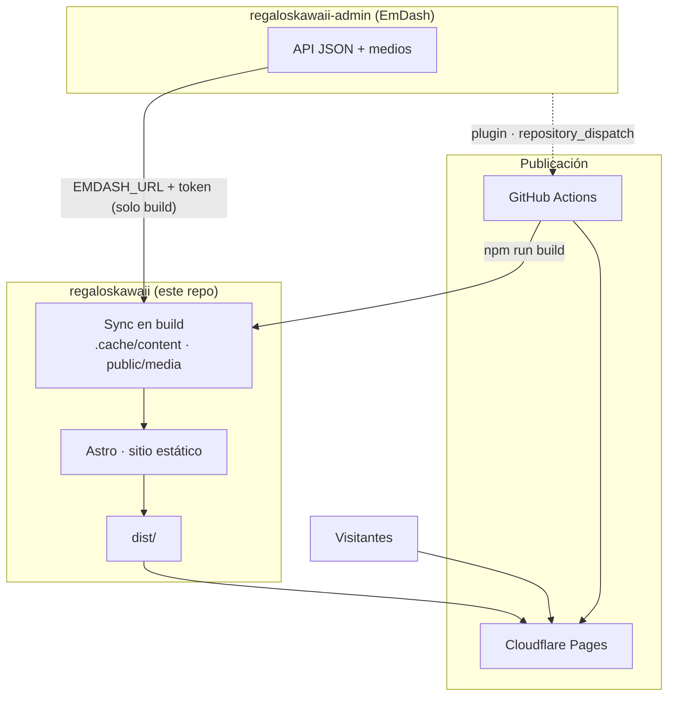

<h1 align="center">
  
   
  Regalos Kawaii
</h1>

**Regalos Kawaii** es la base de código del sitio **[regaloskawaii.es](https://regaloskawaii.es)**: un catálogo curado de ideas de regalo con estética kawaii. La web **no es una tienda**: enlaza a tiendas externas; aquí se elaboran fichas, taxonomías y enlaces de afiliado para ayudar a descubrir productos.

Este repositorio contiene el front estático (**Astro**), la integración con el CMS **EmDash** (contenido e imágenes) y el flujo que empaqueta todo para publicación.

## Arquitectura

**[regaloskawaii-admin](https://github.com/caye-bitdesal/regaloskawaii-admin)** es el proyecto del panel **EmDash** donde se editan productos, taxonomías, páginas y medios. Expone una API HTTP y sirve los ficheros de imagen; no forma parte de este repositorio, pero es la fuente de verdad del contenido.

En **tiempo de build** (local o CI), los scripts `dev` / `build` llaman a esa API con `EMDASH_URL` y un `EMDASH_TOKEN` de solo lectura, vuelcan un snapshot en `.cache/content/` y copian imágenes a `public/media/`. **Astro** genera entonces HTML estático en `dist/`; el token **no** viaja al navegador ni debe aparecer en `dist/` (el workflow lo comprueba).

Para **instalar, desarrollar en local, construir y desplegar**, consulta [DEVELOPMENT.md](./DEVELOPMENT.md).
